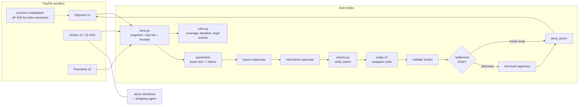

# Architecture

Both Sides is one FastAPI process. It serves a React build and calls the PayPal sandbox REST APIs and any OpenAI-compatible model endpoint. SQLite holds local state, PayPal holds the money state, and the repo holds the demo shop data and the recorded runs.

## The flow, in order

1. **`fetch_snapshot`** reads four things: the dispute; the capture it disputes (amount and Seller Protection status); the order (shipping address, items, trackers); and the shop's own rows for that order (product, size shipped, delivery, refunds, the shopper's instruction for agent purchases).
   - It computes the address match before masking: shipping address versus the address on the transaction.
   - It then masks names, emails, street lines and phone numbers, and stores every response as a receipt.
2. **`build_facts`** turns the snapshot into a flat list like `[pp.capture.amount] Capture amount: 38.00 USD`. Each fact points to its receipt.
3. **`precheck`** (no model) works out:
   - **coverage:** covered, not covered or unknown, plus the rule that fired;
   - **hours left** to respond;
   - **legal actions**, from the action links PayPal returns on the dispute (it lists only the moves allowed right now).
4. **Quarantine.** The buyer's messages go to one model call as data, never as instructions: their words are joined with a marker character so the model can tell them from the prompt. It extracts up to six claims. Code strips instruction-like text and long copied runs. Nothing downstream sees the raw buyer text.
5. **Advocates.**
   - The buyer's advocate assesses each claim against the facts, gives charitable reasons for filing, and proposes an action.
   - The merchant's advocate answers and proposes its own action.
   - A second round runs only when the two proposals differ.
   - `verify_claims` drops any claim that cites a fact that doesn't exist or states a number or delivery status the record contradicts.
6. **Judge.** It runs twice, with the buyer block first and then the merchant block first. If the two readings choose different actions, or both ask for a missing fact, the result is a deadlock. The merchant answers the question and the hearing runs again. A question from only one reading is noted on the verdict and blocks automatic sending.
7. **`validate_verdict`** checks the result against several things:
   - the action must be legal right now;
   - the offer or accept type must be one PayPal lists;
   - the amount must be at most the dispute amount;
   - evidence must be backed by the right kind of fact (tracking for proof of fulfilment, a refund id for proof of refund);
   - every outgoing sentence must cite facts, and its numbers must match them.

   Sentences that fail are dropped, never sent.
8. **Send.** Two paths lead to a PayPal call:
   - **Approval.** The merchant edits and approves. The server re-fetches the dispute and refuses if its status, stage or allowed actions changed since the hearing.
   - **Settlement limits.** These auto-send only a `make-offer` REFUND or a `send-message`, and only when all of these hold:
     - the amount is inside the caps;
     - the reason is allowed;
     - both judge readings fully agree;
     - Seller Protection wouldn't win the case anyway;
     - the facts are complete;
     - this is the dispute's first automatic action.

   Every send is logged with PayPal's debug id. A timeout is recorded as "unknown" until it's checked against the dispute.

## Where state lives

| What | Where | Survives a Render restart? |
|---|---|---|
| Disputes, payments, orders, trackers | PayPal sandbox | yes |
| Product catalogue and policy | `seed/shop.json` (repo) | yes |
| Shop records for hosted auto-ship orders | rebuilt from the order's `custom_id` + tracker | yes |
| Hearings, actions, settlement log, shop orders | SQLite (`backend/data/`) | no (free tier disk) |
| Recorded hearings | `replays/*.json` (repo) | yes |
| Bench results | `bench/results/latest.json` (repo) | yes |

## Safety choices

- Agents hold no credentials. Only `send_action` writes a seller response to a dispute, and only after validation plus either a human approval or a passing settlement-limit check. (The shop's own order, tracking and refund calls, and the sandbox ruling buttons, also write to PayPal.)
- The buyer's text is treated as hostile: it is quarantined and marked as data, and instruction-like phrases are stripped. One bench case is an injection attempt.
- On the hosted demo, a visitor can only approve or adjudicate cases they created there. Shared cases are a dry run.
- On the hosted demo, rate limits apply per IP address on hearings, writes, shop orders and new cases.
